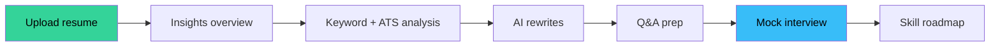

<div align="center">



     


[**Live demo**](https://hiredlens.vercel.app) · [Deploy guide](DEPLOY.md)

</div>

---

## What it does



| Module | Purpose |
|---|---|
| 📊 **Overview** | Resume score and top fixes at a glance |
| 🔑 **Keywords** | ATS keyword coverage against a target role |
| ✍️ **Rewrites** | Stronger bullet points, side by side with the original |
| 💬 **Q&A prep** | Likely interview questions for your profile |
| 🎤 **Mock interview** | Configure and rehearse role-specific interviews |
| 🧭 **Skill roadmap** | What to learn next to close your gaps |
| 🗂️ **History, portfolio, settings** | Track versions and manage your account |

> The UI runs in a demo mode with mocked AI responses so it can be explored without API keys.

## Stack


Next.js 15 (App Router) · React 19 · TypeScript · Tailwind · shadcn/ui · Bun · Vercel

## Local development

```bash
bun install
bun run dev
```

After `bun run dev`, open the URL shown in the terminal (port **3000** unless you changed it).

## Scripts

| Command | Description |
|---------|-------------|
| `bun run dev` | Development server |
| `bun run build` | Production build |
| `bun run start` | Run production server locally |
| `bun run lint` | ESLint |

## Deployment

See **[DEPLOY.md](./DEPLOY.md)** for step-by-step **Vercel** deployment, environment variables, and build notes.

## Environment

Copy `.env.example` to `.env.local`. Variables are documented inline in `.env.example`; `src/lib/env.ts` reads `NEXT_PUBLIC_APP_URL` and `NEXT_PUBLIC_MOCK_REWRITE_DELAY_MS` (see **DEPLOY.md** for Vercel).
# HiredLens

## Built by

[Yash Bankar](https://github.com/yashbank), with AI agents under human-owned design and review.
